<p align="center"></p>

<p align="center"><b>xtermium is a terminal with a session manager.</b> Your SSH, RDP, VNC, telnet, serial, WinRM, website and BMC sessions live in one sidebar and open side by side, in one window.</p>

<p align="center">
  <a href="https://github.com/xtermium/xtermium/releases/latest"></a>
  <a href="LICENSE"></a>
  
  <a href="https://github.com/xtermium/xtermium/releases"></a>
  <a href="https://xtermium.com"></a>
</p>

<p align="center"><a href="https://xtermium.com">Homepage</a> · <a href="https://github.com/xtermium/xtermium/wiki">Docs</a> · <a href="https://xtermium.com/screens">Screens</a> · <a href="https://github.com/xtermium/xtermium/releases/latest">Download</a> · <a href="https://github.com/xtermium/xtermium">Source</a></p>

- **One window, not ten programs.** SSH here, RDP there, a VNC viewer, telnet for the switch, a browser for the console page: xtermium opens them all as tabs and split panes, and types into many at once.
- **Your logins stay locked.** Everything on disk is encrypted with a key in your OS keychain. A recovery passphrase brings it back on a new computer.
- **An agent can use it too.** AI assistants and scripts open sessions, run commands and read the output through the same tools you use, without ever seeing a password.


## Get it

**Windows** (x64). One command fetches the latest release and installs it:

```powershell
irm https://xtermium.com/install.ps1 | iex
```

Or with [Scoop](https://scoop.sh), which keeps your data in Scoop's `persist` folder across updates:

```powershell
scoop bucket add xtermium https://github.com/xtermium/scoop
scoop install xtermium/xtermium
```

Or download from the [latest release](https://github.com/xtermium/xtermium/releases/latest): the installer (`.exe`), the `.msi` for managed deployment, or the portable `.zip` that needs no install.

**Linux** (x64). The script installs the `.deb` where apt is, the `.rpm` where dnf, yum or zypper is, and the AppImage anywhere else:

```sh
curl -fsSL https://xtermium.com/install.sh | sh
```

Or download the `.deb` (Debian, Ubuntu), the `.rpm` (Fedora, RHEL, openSUSE) or the `.AppImage` (any distribution, no install) from the [latest release](https://github.com/xtermium/xtermium/releases/latest).

**macOS** (Apple silicon and Intel). The same script installs the universal app into Applications:

```sh
curl -fsSL https://xtermium.com/install.sh | sh
```

Or download the `.dmg` from the [latest release](https://github.com/xtermium/xtermium/releases/latest) and drag xtermium into Applications.

The macOS app isn't signed or notarized yet: that takes an Apple Developer membership, a yearly fee that waits until community support covers it; sponsoring through [GitHub Sponsors](https://github.com/sponsors/xtonousou) helps pay for it. Until then macOS blocks the first open of a downloaded `.dmg`. Open System Settings › Privacy & Security, scroll to Security, where it says "xtermium" was blocked to protect your Mac, click **Open Anyway** and confirm. The script downloads with curl, which doesn't mark the file as downloaded, so the app it installs shouldn't be blocked. The macOS build is new and hasn't been tried on a Mac yet: if something doesn't work, [open an issue](https://github.com/xtermium/xtermium/issues).

Both scripts check each download against the sha256 GitHub publishes for it before installing anything. Read [install.ps1](https://xtermium.com/install.ps1) or [install.sh](https://xtermium.com/install.sh) first if you like.

### Nightly builds

Main as it stands, built every night it has changed: what the next release will carry, before it has been used for long. The files are on the [nightly pre-release](https://github.com/xtermium/xtermium/releases/tag/nightly) (the same kinds as a release's, named `xtermium_nightly_…`), and on Windows also through Scoop:

```powershell
scoop bucket add xtermium https://github.com/xtermium/scoop
scoop uninstall xtermium          # the release, if it is installed: your data stays
scoop install xtermium/xtermium-nightly
scoop config update_nightly true  # once: Scoop then updates nightly builds, by their date
scoop update xtermium-nightly     # the latest night's build
```

A nightly build installs over the release and opens the same data, so keep a backup you trust (Settings › Import and export › Back up everything…). Settings › About says "nightly" with the commit it was built from, and its update check looks for a later nightly. To go back, install the latest release again.

## Contents

- **Start:** [Get it](#get-it) · [What you get](#what-you-get) · [Using it](#using-it)
- **What you get:** [Connections](#connections) · [Sessions and workspaces](#sessions-and-workspaces) · [Working in it](#working-in-it) · [Keeping it safe](#keeping-it-safe) · [Agents and scripts](#agents-and-scripts) · [Looks](#looks) · [Sync](#sync) · [Around the app](#around-the-app)
- **Under the hood:** [Configuration](#configuration) · [Security notes](#security-notes)
- **Build it yourself:** [Requirements](#requirements) · [Build and run](#build-and-run) · [Architecture](#architecture) · [Development](#development)
- [License and credits](#license-and-credits)

## What you get

Every feature is free except two that need **Pro**, a hosted service: sync and Terminal Co-op. Each group below says what you get in a line or two; open its details for the exact menus, formats and limits.

### Connections

- **SSH** with keys, your SSH agent, passwords and jump hosts. A dropped connection comes back by itself.
- **RDP** desktops in a tab. A connection lost on the network reconnects on its own, and the host's shared folders open beside it.
- **VNC** desktops in a tab, sized to the pane where the server allows it.
- **Telnet** for switches, routers and serial servers.
- **Serial ports and the local shell**, in tabs like any other session.
- **WinRM**: PowerShell on a Windows host, as your Windows login or as a user.
- **Websites and BMC consoles**, in your browser or in a tab, each website with its own cookies and sign-ins.
- **SSH tunnels**, local, remote and SOCKS5, with a live picture of their traffic.

<details>
<summary>Connection details</summary>

- **SSH:** agent (OpenSSH / Pageant on Windows), key files (with a passphrase prompt), password and keyboard-interactive, optional "remember the password" (Settings › Saved logins lists, changes and forgets them), jump hosts, agent forwarding (per session, off by default), host-key trust-on-first-use, and reconnecting by itself when a connection drops.
- **RDP**, embedded in a tab via IronRDP: NLA/NTLM login, server-key trust-on-first-use, keyboard and mouse. A connection lost on the network (a laptop waking up, a router restarting) reconnects on its own. Keys held when the tab loses the keyboard are let go on the desktop, so none stays stuck. Caps, Num and Scroll Lock follow this computer's. Pasted and typed text arrives intact, accents and AltGr characters included. The file panel opens the host's shared folders (SMB) with the desktop's login once it's connected (Settings › Defaults, or per session), or asks which account; a session can turn its shared folders off.
- **VNC**, embedded in a tab via vnc-rs (MIT/Apache): ZRLE, TRLE, CopyRect and Raw, VNC password (remembered if you like, under Settings › Saved logins), the desktop following the pane where the server allows it. VNC isn't encrypted: every connection says so over the desktop, unless it goes through an SSH gateway or a tunnel's local port.
- **Telnet:** window-size and terminal-type negotiation. Imported from MobaXterm too; `telnet host` in the command palette connects.
- **Local shell and serial ports:** ConPTY on Windows, a pty elsewhere. Settings › Defaults picks the program for Local shell. With no tabs open, start typing on the start screen: a local shell opens and gets everything you typed, the first key included (Settings › General can turn this off). On Windows, Settings › General can add **Open in xtermium** to folders in File Explorer (a folder, its background, a drive): a local shell starts in that folder, in the running xtermium if there is one.
- **WinRM (PowerShell remoting):** the local PowerShell (7 if installed) enters a session on a Windows host, as your Windows login or as a user. The user's password comes from the session's shared login, else a remembered one (Settings › Saved logins), else xtermium asks and can remember it; one the host refuses is forgotten. It reaches PowerShell in an environment variable that PowerShell removes at once, never on the command line.
- **Websites and BMC consoles:** browser sessions open in your default browser, or in a tab (Settings › Browser › Embedded) with the system's own browser engine: WebView2 on Windows, WebKit on macOS and Linux, as a native view that follows its pane. Each website session has its own cookies and sign-ins, kept when xtermium restarts, in a profile of its own (in the data folder; a deleted session's goes at the next start). BMC consoles and websites that aren't saved browse privately and keep nothing once closed. Pages can't reach xtermium itself, and while a dialog or menu is over the tab, the page steps aside so it doesn't cover it. Pages are kept from timing out (a mouse move now and then, and a quiet request for the page), and a website can go through its login's SSH gateway. A website session without an icon of its own takes the site's (its favicon) when it's saved or opened; "Website icon" in the session editor fetches it again. Supermicro and iDRAC consoles open the same way.
- **SSH tunnels** (local, remote, dynamic/SOCKS5) with a live traffic-flow diagram: throughput per direction, active and total connections, bytes, and a 60-second sparkline. A tunnel whose connection drops connects again by itself (waiting 1, 2, 4... up to 30 s between tries) while its local port stays open, keepalives notice a quiet mobile link within a minute, and a 16 MB window per channel keeps gigabit links full even far away. Tunnels can start when xtermium opens, and can go through their login's SSH gateway.

</details>

### Sessions and workspaces

- **A folder tree with search.** Type a name, press Enter, and you're on the session in the tree.
- **Shared logins.** Keep a user, password and key once, and let any number of sessions use it. Change the password once; every session uses the new one.
- **An SSH gateway on a login.** Sessions that pick the login reach their hosts through it: SSH, RDP, VNC and websites alike.
- **Workspaces.** Separate sets of sessions and folders, one dropdown away. Clone one, or sync one into another.
- **Import and export.** Bring sessions in from a bookmarks `.ini` file, and export a folder to a passphrase-protected `.xtermium` file.

<details>
<summary>Session and workspace details</summary>

- **Sessions:** folder tree with search (Enter puts you on the session in the tree), edit, duplicate and delete (Ctrl+click and Shift+click pick several, to drag into a folder, delete, or move to another workspace together), plus a start dashboard. Sessions can be imported from a bookmarks `.ini` file: folders, per-session font, colours and TERM, jump hosts and tunnels. Stored passwords are not imported.
- **Folders:** right-click one to rename it, tag it (search finds every session under a matching tag), add a session to it, delete it, or export it to a passphrase-protected `.xtermium` file that Import reads back.
- **Shared logins:** a user, password and key kept once (command palette › Shared logins, or Manage… next to a session's Login) and picked by any number of SSH, RDP, VNC and WinRM sessions, jump hosts and tunnels. Stored encrypted with the sessions and synced with them; never written into exports other than the passphrase-protected `.xtermium` file.
- **SSH gateway:** a login can carry one (host, port, user, password or key). SSH sessions without a jump host of their own use it as one, RDP and VNC reach their host through a port forwarded over it, and website sessions (which can pick a login for this) send every request through it as a SOCKS proxy, internal host names included.
- **Workspaces:** each holds its own sessions and folders; shared and saved logins, tunnels, snippets, layouts, trusted keys and settings are the same in all of them. Switch from the dropdown next to the sidebar's search; Settings › Workspaces adds, renames and deletes them. Right-click sessions or folders › Move to workspace… takes them to another. **Clone** copies a workspace's sessions and folders ("Work (clone)"). **Sync** brings one workspace's sessions and folders into another: what both have is updated, what's new is added, nothing is removed, and a restore point is kept first. They all sync and go into backups.

</details>

### Working in it

- **Split panes** side by side, stacked, 2×2, or as tiles for any tabs you tick, terminals and desktops alike.
- **Broadcast** (Ctrl+Shift+A): type once, and it goes to every ticked terminal.
- **Saved layouts** put a whole screen of sessions back, each in its pane and named as it was, in one click.
- **Snippets** are saved commands with `{{name}}` placeholders, typed into one tab or all ticked ones (Ctrl+Shift+S).
- **A file panel** for SSH and VNC tabs: browse, drag files in and download over SFTP. Beside an SSH shell it follows the shell's folder.
- **A status bar** with the connection, how long it's been up, and for SSH the cipher and a live round trip.
- **A tab in its own window**: move a terminal or a remote desktop out, and back when you're done.
- **Open in VS Code** opens the folder you're in, on this computer or on the SSH host.
- **Pictures in the terminal**: kitty, sixel and OSC 1337 images.
- **The command palette** finds sessions, tabs, tunnels, snippets and layouts by name.
- **One title bar on every system:** xtermium draws its own, so Windows, Linux and macOS look alike (macOS keeps its three buttons). Its centre names the focused tab, where your typing goes, and a click on it opens the command palette.
- **Terminal Co-op** (Pro, Ctrl+Shift+G): share tabs with up to two other people, who type and click in them. Everything goes straight between your computers, end-to-end encrypted.


<details>
<summary>Working details</summary>

- **Split panes** (side by side, stacked, 2×2, or tiles: tick any tabs, SSH, RDP, VNC, website or other, and each gets a pane sized to fit) and **broadcast** (Ctrl+Shift+A, for "all"): keystrokes typed in one terminal are replayed into every ticked terminal tab, encoded for each tab's own terminal modes.
- **Saved layouts:** the Layouts button next to the layout picker saves the sessions on screen under a name ("Prod web tier"): their arrangement, the pane each is in, the names their tabs were given and the panes' sizes. Opening it later puts each session back in its pane, named and sized as it was, in one click (or from the command palette). Every workspace has the same ones.
- **Snippets:** saved commands typed into the focused terminal, or every ticked tab with broadcast on (Ctrl+Shift+S, or the command palette). `{{name}}` placeholders are asked for when one runs. They're stored and synced with the sessions.
- **SFTP side panel** for SSH tabs, over the same connection, and for VNC tabs, over an SSH connection of its own to the desktop's host (as its shared login's user, through the login's gateway). Browse, download (to your Downloads folder), drag files in to upload, rename, delete, create folders, with progress bars. A panel is named and coloured as its tab is. With several tabs on screen (split panes, broadcast), three panels show at most: the focused pane's and the first others; with more tabs than that, a chip under the panels for each tab picks whose to show.
- **The shell's folder:** the file panel follows it when the shell reports it (OSC 7), and so does Open in VS Code, which on a Linux host finds it by itself otherwise. fish reports it by itself. For bash, add this to `~/.bashrc`, and for zsh the same in `precmd`:

  ```bash
  PROMPT_COMMAND='printf "\e]7;file://%s%s\e\\" "$HOSTNAME" "$PWD"'
  ```

- **Status bar:** the focused tab's connection, how long it's been up, and for SSH the negotiated cipher and a live round trip; the terminal's size. Settings › General hides it.
- **Tabs in their own window:** right-click a terminal or RDP tab › Move to a new window. The session goes on there, with nothing around it. Right-click in it (Ctrl+right-click on a remote desktop) or close the window to put it back. Ctrl+= / Ctrl+- zoom one tab's font.
- **Terminal Co-op** (Pro; Ctrl+Shift+G, or Settings › Account and sync): start a ring, give its passcode to up to two other signed-in people, and say yes as they ask to join. Right-click one of your tabs › Share with the ring puts a terminal, a remote desktop (RDP or VNC) or, on Windows, a website in front of everyone in it; AI agent tabs can't be shared. A shared tab opens as a tab of its own for the others, shown at your size, and they can type and click in it. Everyone's pointer shows over a shared tab with their picture. You can take anyone out or end the ring at any time, and the passcode works for ten minutes before you need a new one. What you share goes straight between the computers, end-to-end encrypted; the sync server only introduces them and never sees a keystroke or a screen. A ring ends by itself if the owner's Pro does.
- **Zoom with the mouse wheel:** Ctrl+wheel (⌘+wheel on macOS) over a terminal zooms that tab's font like Ctrl+= / Ctrl+-. Ctrl+Shift+wheel, off until you turn it on, changes every terminal's font size (Settings › Terminal). Settings › Shortcuts rebinds both to any of Ctrl, Alt, Shift or Meta with the wheel.
- **Open in VS Code:** right-click an SSH, local shell or AI agent tab › Open the folder in VS Code (its `code` command has to be on your PATH). A local folder opens as it is; an SSH session's opens on its host through VS Code's Remote-SSH extension, as the session's user and port. VS Code signs in by itself (keys and agent, or it asks for the password); a jump host or key file has to be in `~/.ssh/config` for it. The folder is the shell's: as the shell reports it (OSC 7, as for the SFTP panel), else on a Linux host the one it is in, asked over the same connection; else your home folder on the host, or the tab's starting folder.
- **Scroll bar** on terminals (Settings › Terminal), to see and drag where you are in the scrollback. Scrolled back, new output leaves what you're reading where it is, or brings you to the bottom if you turn on "Scroll to the bottom on output".
- **Clipboard behaviour** and the Websites mode are in Settings too.

</details>

### Keeping it safe

- **Encrypted on disk.** Everything xtermium keeps is encrypted, with the key in your OS keychain, so there's nothing to type day to day. A recovery passphrase brings it back on a new computer ([Configuration](#configuration)).
- **A lock for when you step away.** A password, a PIN, a passkey or Windows Hello. Your sessions keep running behind it, and agents and scripts are refused until you unlock.
- **Restore points.** A full copy of everything each day and before each restore, plus any you take.
- **Host keys you trust once.** SSH host keys and RDP server keys are confirmed the first time; a changed key refuses the connection instead of asking.
- **Passwords stay out of exports.** Shared logins go only into the passphrase-protected `.xtermium` file, and remembered passwords stay on this computer.
- **Your SSH keys, in one place.** See the key pairs in `~/.ssh`, copy their public keys, and make new ones.

<details>
<summary>Safety details</summary>

- **Lock:** for stepping away from the computer, Settings › Security sets a password, a PIN, a passkey (a security key or the computer's own) and Windows Hello (face, fingerprint or Windows' PIN) to unlock with. Locked, every window shows only the lock screen while the sessions keep running, and the MCP server and the `xtermium` command line refuse every tool until you unlock. It locks when xtermium starts, with Ctrl+Shift+K or the lock beside Settings, and after the minutes you pick without input; changing it takes an unlock first, and wrong passwords and PINs make the next try wait.
- **Restore points:** Settings › Import and export keeps full copies of everything (sessions, logins, tunnels, snippets, settings, trusted keys) on this computer: one a day, one before each restore, and any you take; the newest 10 stay. Restoring one can also replace the cloud copy.
- **Settings › Security** also holds the recovery passphrase (changing it takes the current one) and the trusted server keys (remove one after a server's key changed on purpose).
- **Settings › SSH keys:** the key pairs in `~/.ssh` with their public keys to copy, and new ones (Ed25519 by default, ECDSA P-256 or RSA 4096, with a passphrase if you like).
- How the encryption works, and what's stored where: [Configuration](#configuration). What to watch for: [Security notes](#security-notes).

</details>

### Agents and scripts

- **An MCP server and a command line.** Settings › MCP turns on a local MCP server behind a token for AI assistants; the `xtermium` command drives the same tools from scripts (`xtermium help`).
- **They work the way you do.** Open sessions, run commands and read terminals, drive remote desktops and website tabs, start tunnels, switch workspaces and detach tabs.
- **Agents in a tab.** Save AI agents as sessions, pick each one's folder and how often it asks first. With the MCP server on, most get xtermium's tools without setup. Each session lists the MCP servers its tool would start there (xtermium's among them) and leaves the ones you untick off in that session only, without changing the tool's own settings (Claude Code, Codex, OpenCode and Copilot; Cursor's CLI has no way to).
- **What they never see:** passwords and agent tabs. While xtermium is locked, every tool answers that it's locked.


<details>
<summary>Automation details</summary>

- **Automation:** Settings › MCP lets AI assistants (MCP over HTTP on 127.0.0.1, with a token) and scripts (`xtermium help`) list and open sessions, run commands and read terminals, drive remote desktops and website tabs (read the page and its elements, click, fill fields, go to addresses, run a script in the page, and on Windows take screenshots, all through the tab itself with no browser or DevTools of their own), start tunnels, switch workspaces, clone and sync them, move sessions between them, detach tabs and keep restore points.
- **On the network:** it listens on this computer only, or on the network (0.0.0.0) for assistants running on other machines, over HTTPS with a self-signed certificate (its SHA-256 fingerprint is shown); the commands to add it start those assistants with certificate checks off.
- **While locked** (Settings › Security) every tool answers that it's locked; the MCP handshake still works, so assistants keep the server and carry on after you unlock.

</details>

### Looks

- **Light, dark or system theme**, and an interface scale.
- **Ten terminal colour schemes**, your font and size, the cursor shape.
- **A see-through window**, with one opacity setting for all of it.
- **Backgrounds** behind terminals, the sidebar and the tab bar: a picture, or a GLSL shader.
- **Highlight rules** colour `ERROR`, `WARN`, IP addresses or any pattern in output, which helps when tailing logs.
- **Your own stylesheet**: a `custom.css` in the data folder restyles the interface ([Configuration](#configuration)).

<details>
<summary>Look details</summary>

- The Transparent effect comes with one opacity setting, the same for the sidebar, the bars and terminals. The terminal settings also set the scrollback.
- **Backgrounds** (Settings › Appearance): a PNG, JPEG, GIF, WebP or SVG picture, or a GLSL shader (Shadertoy's `mainImage`, or one with its own `main()`), from a file or a link, under the place's colour at the strength you set; a picture fills, stretches, fits, tiles or sits centred.
- **Highlight rules:** Settings › Terminal colours matches of regular expressions in output. Only text the program printed in the normal colour is coloured. Comes with rules for errors, warnings, successes and IPv4/IPv6 addresses.
- **Languages:** the interface comes in English, Arabic (right to left), Chinese (Simplified), Finnish, French, German, Greek, Hindi, Japanese, Norwegian Bokmål, Polish, Spanish and Swedish.

</details>

### Sync

Sync is part of **Pro**, xtermium's one paid plan, a hosted service; [Terminal Co-op](#working-in-it) needs it too. It isn't open yet. Until it is, a passphrase-protected `.xtermium` export moves sessions by hand.

- **What syncs:** your sessions, folders and workspaces, shared logins, tunnels, snippets, layouts and trusted host keys.
- **What syncs only when you tick it** (Settings › Account and sync): your settings, backgrounds and the passwords you chose to remember.
- **Encrypted before it leaves.** Everything is end-to-end encrypted: the sync server only ever holds files it can't read.

The sync server is proprietary and not in this repository; the client talks to it through the open API in [docs/sync.md](docs/sync.md).

### Around the app

- **Start when you sign in**, and get desktop notifications for a new version or a connection that dropped (off by default).
- **No surprise updates.** xtermium tells you when a new release is out; installing it is up to you.
- **Shortcuts are yours to change**, in Settings › Shortcuts.
- **Portable mode**: point `XTERMIUM_HOME` at a folder and xtermium keeps its data there ([Configuration](#configuration)).
- **Help when it breaks**: Settings › Troubleshoot makes a bundle to send to [support@xtermium.com](mailto:support@xtermium.com).

<details>
<summary>App details</summary>

- **This computer** (Settings › General): start xtermium when you sign in, desktop notifications (a new version, a connection that dropped; off by default), and running above the normal process priority (may need administrator rights).
- **Settings › About** shows the version (semantic versioning; each release on GitHub lists what changed since the one before), build number and kind of build, checks GitHub for a newer release (a quiet check at start, which "Tell me when a new version is out" turns off) and opens the download for this computer. Installing it is up to you; xtermium never updates itself.
- **Settings › Troubleshoot** makes a bundle: a .zip of plain-text files about the installation (version, system, settings without secrets, counts of what's stored and open) to send to [support@xtermium.com](mailto:support@xtermium.com). Your user and computer names, your home folder and any email or IP address are taken out before it's written.
- **Settings › Defaults:** the program for Local shell, and the SSH user, key and password used when a session leaves them empty.

</details>

## Using it

- Double-click a session in the sidebar to open it. Right-click it to edit, duplicate or delete; right-click a folder to rename, tag, export or delete it.
- Click a tab to show it in the focused pane. Middle-click a tab, or press its ×, to close it.
- Point at a button to see what it does and its shortcut; menus show their items' shortcuts too (Settings › Shortcuts changes them).
- Shortcuts follow the system. This README gives Windows' keys. On macOS ⌘ takes Ctrl's place in xtermium's own shortcuts and Ctrl stays the terminal's: ⇧⌘P the command palette, ⌘T a local shell, ⌘N a new session, ⌘W closes a tab, ⌘F finds in the terminal, ⌘1 … ⌘9 go to a tab, ⌥⌘ arrows focus the pane that way, ⌘, opens Settings, ⌃⌘F full screen, and ⇧⌘ with the same letter for the rest (⇧⌘A broadcast, ⇧⌘S snippets, ⇧⌘K lock). Linux uses Windows' keys, except Tunnels: Ctrl+Shift+Y, since GTK keeps Ctrl+Shift+U for typing a Unicode character.

| In a terminal | |
|---|---|
| Select text | copies it (can be turned off in Settings) |
| Right-click, Shift+Insert, Ctrl+Shift+V (⌘V on macOS) | paste |
| Ctrl+Shift+C (⌘C on macOS) | copy the selection |
| Shift+PgUp / Shift+PgDn, mouse wheel | scroll back |
| Shift + drag | select even when the program captures the mouse |
| Ctrl+click (⌘-click on macOS) a link | opens it in your browser (web addresses in the text, and links programs print with OSC 8) |
| Ctrl+Shift+F (⌘F on macOS) | find in the scrollback: Enter for older matches, Shift+Enter for newer, Esc closes |
| R (after a session ends) | reconnect, in the same terminal: the earlier output stays above |
| Return, Esc, Backspace or Ctrl+C (after a session ends or fails to connect) | close the tab (also on a remote desktop that couldn't connect) |
| Ctrl+Shift+←/→/↑/↓ (⇧⌘ arrows on macOS) | with several panes, swap the focused pane with the one that way |
| Shift+Alt+←/→/↑/↓ (⌃⌘ arrows on macOS) | with several panes, move the focused pane's edge that way (the step is in Settings › Terminal) |

| In an RDP tab | |
|---|---|
| Typing, Ctrl/Alt chords, mouse | forwarded to the remote desktop |
| Shift+Insert, Ctrl+Shift+V | types your local clipboard into the session (the clipboard itself isn't shared) |

## Configuration

Everything xtermium keeps lives in one folder, `~/.xtermium` (`%USERPROFILE%\.xtermium` on Windows): settings and sessions, terminal logs, website profiles, the windows' browser data and what a run needs only while it runs (`temp`, cleared at the next start). Set `XTERMIUM_HOME` to use another folder (portable mode). The first start of this version moves the data from where older ones kept it (`%APPDATA%\xtermium\config`, `~/.config/xtermium` or `~/Library/Application Support/xtermium`). Only the data key stays outside, in the OS keychain (below); macOS keeps the windows' browser data in its own place.

| File | Contents |
|---|---|
| `sessions.xtm` | sessions, folders and their tags, logins, tunnels, snippets, saved layouts, workspaces |
| `settings.xtm` | everything in the Settings window, including the default SSH password |
| `known.xtm` | trusted SSH host keys and RDP server keys |
| `lock.xtm` | the lock: its password and PIN as Argon2id hashes, the passkey's public key, when it locks |
| `recovery.key` | the data key, sealed under your recovery passphrase |

All `.xtm` files are encrypted with XChaCha20-Poly1305 under a random 256-bit data key. The key lives in the OS keychain (Windows Credential Manager, macOS Keychain, Secret Service on Linux), so there's nothing to type day to day.

- **Recovery passphrase:** set one under Settings › Security. On a new computer, after a reinstall, or if the keychain entry is lost, xtermium asks for it and unlocks everything. Without it, a lost keychain entry means the files can't be read.
- **Post-quantum safety:** only symmetric cryptography is used (XChaCha20-Poly1305, Argon2id for passphrases). Quantum computers threaten public-key schemes, and 256-bit symmetric keys stay secure.
- **Upgrading:** the first start of this version encrypts the old plain-text `sessions.toml`, `settings.toml`, `known_hosts` and `known_rdp`, checks the result and deletes the plain-text files.
- **Remembered passwords:** "Remember" stores a session's password in `logins.xtm`, on this computer only unless you tick "Saved logins and passwords" in Settings › Account and sync.
- **custom.css:** a `custom.css` in the data folder restyles the interface (the tokens and classes are in `ui/app.css` and `DESIGN.md`). It's applied at start; one that changed since you last kept it is tried for 30 seconds and taken off unless you keep it, so a stylesheet that hides the window can't lock you out.

The formats, and the API a sync server would need, are in [docs/sync.md](docs/sync.md).

## Security notes

- **Trust on first use:** SSH host keys and RDP server keys are confirmed the first time you connect. A changed key refuses the connection instead of asking.
- **Imported tunnels** keep the bind address from the imported file, which is often `0.0.0.0`, meaning reachable from your network. New tunnels default to `127.0.0.1`.
- **`cargo audit`:** two advisories are accepted, with the reasons in `.cargo/audit.toml` and `rdp/.cargo/audit.toml`:
  - `rsa` "Marvin" timing attack: no fix exists, and exposure is low (one signature per login).
  - `lru` unsoundness: not reachable here, because the only cache's keys can't panic on drop.
- Unmaintained or unsound deep dependencies (`adler`, `paste`, `proc-macro-error`, and `glib`, which Tauri uses on Linux) show as warnings only.
- The UI runs under a strict content security policy (`tauri.conf.json`), and its only permissions beyond xtermium's own commands are listed in `capabilities/default.json`.

## Requirements

- Rust 1.91 or newer, and Node.js 20 or newer with npm.
- On Linux, the WebKitGTK development packages that Tauri needs (see the [Tauri prerequisites](https://v2.tauri.app/start/prerequisites/)). Windows 10/11 ship WebView2.
- Windows: long git paths. The WezTerm git dependency contains paths longer than 260 characters. If `cargo fetch` fails with `path too long`, run `git config --global core.longpaths true`, or run that one fetch with a `HOME`/`USERPROFILE` whose `.gitconfig` sets it.

## Build and run

```sh
npm install
npm run tauri build
target/release/xtermium
```

`npm run tauri build` does three things:

- builds `xtermium-rdp`, the RDP helper, which is its own crate in `rdp/`
- builds the UI into `dist/`
- compiles the app with the UI embedded, and makes the installers (`target/release/bundle/msi` and `nsis` on Windows)

The helper ships next to `xtermium` in every build and installer, which is where the app looks for it. Add `-- --no-bundle` to skip the installers.

While working on it, use `npm run tauri dev`. That starts Vite and a debug build that reloads the UI as you edit `ui/`, and rebuilds the Rust side when `src/` changes. For a standalone debug exe, use `npm run tauri build -- --debug --no-bundle`.

A plain `cargo build`, `cargo test` or `cargo clippy` needs the helper to have been built once (`npm run rdp`), because Tauri checks the files it bundles. A plain `cargo build` also gives the dev-mode binary, which expects the Vite server on port 1420.

Dependencies are compiled with optimizations even in dev builds, because graphics-heavy sessions crawl without it. The first build therefore takes a few minutes.

## Architecture

The backend is Rust on tokio: WezTerm's VT engine (kitty, sixel and OSC 1337 images), SSH, SFTP, RDP and tunnels. The interface is TypeScript and Svelte in a Tauri window.

The Rust backend owns all state and connections; the UI calls it through Tauri commands. Each terminal tab streams to the UI over its own channel: a frame holds only the rows that changed since the last one (as runs of identically styled cells), the cursor, the title and image placements. Images are sent once, by hash, and decoded by the webview. The UI keeps the screen model and paints it on a canvas. Keys and mouse go back as events, and the backend encodes them for the terminal's current modes. RDP tabs stream the helper's dirty rectangles the same way.

| Path | What |
|---|---|
| `src/main.rs` | app state and the Tauri commands, tabs, broadcast |
| `src/term.rs` | terminal tab: wezterm-term engine, frame diffing, keyboard and mouse, highlight rules, PTY, serial and telnet backends |
| `src/ssh.rs` | SSH connect and auth, host keys, jump hosts, shell, SFTP channel, tunnels and SOCKS5 |
| `src/sftp.rs` | SFTP browser state and transfers, published to the UI as `sftp` events |
| `src/rdp.rs` | RDP tab: runs `xtermium-rdp`, relays its frames and the UI's input |
| `src/rdp_proto.rs` | stdin/stdout wire format between the app and `xtermium-rdp` |
| `src/flow.rs` | running tunnels and their traffic samples |
| `src/settings.rs` | settings and colour schemes |
| `src/config.rs` | sessions, folders and tunnels; trusted server keys; the data key, encrypted reads and writes, migration |
| `src/vault.rs` | encryption: sealed files, recovery key, passphrase-protected exports |
| `src/import.rs` | bookmarks `.ini` importer |
| `src/prompt.rs` | password and confirmation prompts from background tasks (`prompt` events) |
| `ui/App.svelte` | window layout: toolbar, sidebar, tabs and split panes, dashboard, prompts, import |
| `ui/lib/Terminal.svelte` | canvas renderer and input for terminal tabs |
| `ui/lib/Rdp.svelte` | RDP view and input |
| `ui/lib/` (others) | sidebar, session editor, SFTP panel, tunnels and flow diagram, settings, about, Boxicons |
| `rdp/` | `xtermium-rdp`, the RDP helper (IronRDP), with its own `Cargo.lock` because IronRDP and russh pin incompatible pre-release crypto crates |

## Development

```sh
cargo fmt && cargo clippy --all-targets && cargo test
(cd rdp && cargo fmt && cargo clippy --all-targets)
npm run check
cargo audit && (cd rdp && cargo audit) && npm audit
```

To contribute, read [CONTRIBUTING.md](CONTRIBUTING.md): changes reach `main` only as pull requests from `feat/` or `fix/` branches.

The tests include an end-to-end SSH run against an in-process server: host-key prompt, password auth, shell, SFTP and a local tunnel. They also cover the importer, the RDP wire protocol and key scancodes, the SOCKS5 handshake, broadcast key encoding, and highlight rules. `npm run check` type-checks the UI.

## License and credits

xtermium is licensed under the Apache License 2.0 (`LICENSE`). Copyright © 2026 Sotirios Roussis. You may use, change, rename and share it, commercially or not. Every copy and fork must keep `LICENSE` and the credit in `NOTICE`, and a fork that shows credits must show that one among them.

The cloud sync server is not part of this repository. It is proprietary, and so is the hosted sync service. The client in this repository talks to it through the open API in [docs/sync.md](docs/sync.md). "xtermium" and its logo are trademarks of the author, and forks must use another name.

Third-party parts keep their own licenses, quoted in full in `THIRD-PARTY-NOTICES.txt`; the installers carry it next to `LICENSE` and `NOTICE`, and Settings › About opens it. `npm run notices` rewrites it (it needs `cargo install --locked cargo-about --features cli`), and every release build does. Icons: [Boxicons](https://boxicons.com) (MIT, `assets/icons/LICENSE-boxicons`). Type: [JetBrains Mono](https://www.jetbrains.com/lp/mono/) (SIL Open Font License, bundled from `@fontsource-variable/jetbrains-mono`; the README's hero embeds it in `assets/readme/hero.svg`). Built on Tauri, Svelte, wezterm-term, russh, russh-sftp, IronRDP, portable-pty and serialport. Logo, logo animations, colours and the design system by [dehawk](https://github.com/dehawk202).

<p align="center"><b>Star it if it saves you a window.</b></p>
